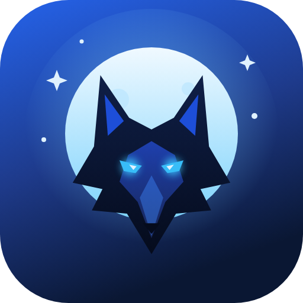

<div align="center">



# 🐺 WERWOLF MOBILE

### _Das ultimative Werwolf-Spiel für dein Handy_

<br>

[](https://emre1001.github.io/Werwolf-Mobile/)
[](https://emre1001.github.io/Werwolf-Mobile/)
[](https://firebase.google.com)
[](LICENSE)
[]()

<br>

> _Spiele das klassische Werwolf-Kartenspiel digital – mit Freunden online oder lokal auf einem Gerät._
> _Echtzeit-Synchronisation, automatischer Erzähler, Chat-System und **10 einzigartige Rollen!**_

<br>

---

</div>

<br>

## ✨ Features

<table>
<tr>
<td width="50%">

### 🌐 Online-Modus
Spiele mit Freunden über das Internet. Jeder auf seinem eigenen Gerät. Echtzeit-Synchronisation über Firebase.

### 🏠 Lokal-Modus
Ein Gerät, ein menschlicher Erzähler. Perfekt für Partys und Spieleabende.

### 💬 Intelligentes Chat-System
- **Tag:** Öffentlicher Chat für alle
- **Nacht:** Privater Werwolf-Chat
- **Tod:** Geister-Chat für Eliminierte

</td>
<td width="50%">

### 🤖 Automatischer Erzähler
Im Online-Modus übernimmt das System die Spielleitung. Kein menschlicher Erzähler nötig.

### 📱 Progressive Web App
Installierbar auf jedem Gerät. Funktioniert wie eine native App mit Offline-Support.

### 🎨 Atemberaubendes Design
Glasmorphismus-UI, Partikel-Hintergrund, flüssige Animationen und Tag/Nacht-Übergänge.

</td>
</tr>
</table>

<br>

## 🎭 Rollen

> Jede Rolle hat eine einzigartige Fähigkeit, die das Spiel spannend und strategisch macht.

<table align="center">
<tr>
<th>Rolle</th>
<th>Fähigkeit</th>
<th>Team</th>
</tr>
<tr>
<td>🐺 <b>Werwolf</b></td>
<td>Wählt nachts gemeinsam mit anderen Wölfen ein Opfer</td>
<td>🔴 Werwölfe</td>
</tr>
<tr>
<td>🏘️ <b>Dorfbewohner</b></td>
<td>Keine Spezialfähigkeit – deine Stimme bei der Abstimmung zählt!</td>
<td>🟢 Dorf</td>
</tr>
<tr>
<td>🔮 <b>Seherin</b></td>
<td>Kann jede Nacht die wahre Rolle eines Spielers aufdecken</td>
<td>🟢 Dorf</td>
</tr>
<tr>
<td>🧪 <b>Hexe</b></td>
<td>Besitzt einen Heiltrank (rettet Opfer) und einen Gifttrank (tötet)</td>
<td>🟢 Dorf</td>
</tr>
<tr>
<td>💘 <b>Amor</b></td>
<td>Bestimmt in der ersten Nacht zwei Liebende – stirbt einer, stirbt auch der andere</td>
<td>🟢 Dorf</td>
</tr>
<tr>
<td>🎯 <b>Jäger</b></td>
<td>Wenn er stirbt, nimmt er einen anderen Spieler seiner Wahl mit</td>
<td>🟢 Dorf</td>
</tr>
<tr>
<td>👧 <b>Kleines Mädchen</b></td>
<td>Kann die Werwölfe ausspionieren – mit 50% Risiko entdeckt zu werden!</td>
<td>🟢 Dorf</td>
</tr>
<tr>
<td>🛡️ <b>Beschützer</b></td>
<td>Schützt jede Nacht einen Spieler vor dem Tod (nicht zweimal denselben)</td>
<td>🟢 Dorf</td>
</tr>
<tr>
<td>👑 <b>Prinz</b></td>
<td>Überlebt die erste Hinrichtung durch das Dorf</td>
<td>🟢 Dorf</td>
</tr>
<tr>
<td>👴 <b>Älteste</b></td>
<td>Überlebt den ersten Werwolf-Angriff</td>
<td>🟢 Dorf</td>
</tr>
</table>

<br>

## 🎮 Spielablauf

<table>
<tr>
<td align="center" width="25%">

### 🌙 Nacht

Das Dorf schläft. Die Werwölfe erwachen und wählen ein Opfer. Spezialrollen führen ihre Aktionen aus.

</td>
<td align="center" width="25%">

### ☀️ Tag

Das Dorf erwacht. Ein Opfer wurde gefunden! Alle diskutieren: Wer könnte ein Werwolf sein?

</td>
<td align="center" width="25%">

### 🗳️ Abstimmung

Das Dorf stimmt ab. Der Spieler mit den meisten Stimmen wird hingerichtet.

</td>
<td align="center" width="25%">

### 🏆 Sieg

**Dorf gewinnt:** Alle Werwölfe eliminiert.
**Werwölfe gewinnen:** Gleich viele oder mehr als Dorfbewohner.

</td>
</tr>
</table>

<br>

## 🚀 Schnellstart

```
1. 🌐  Öffne die Live-Demo → https://emre1001.github.io/Werwolf-Mobile/
2. ✏️  Gib deinen Spielernamen ein
3. 🏠  Erstelle eine Lobby (öffentlich oder privat)
4. 📤  Teile den 6-stelligen Code mit Freunden
5. 👥  Warte auf mindestens 4 Spieler
6. 🎮  Host startet das Spiel – Rollen werden automatisch verteilt!
```

<br>

## 🛠️ Tech Stack

| Technologie | Verwendung |
|-------------|-----------|
| **Vanilla JavaScript** | Gesamte App-Logik, kein Framework |
| **CSS3** | Glasmorphismus, Animationen, Responsive Design |
| **Firebase Firestore** | Echtzeit-Datenbank für Multiplayer-Sync |
| **Canvas API** | Partikel-Konstellations-Hintergrund |
| **Service Worker** | Offline-Support und PWA-Caching |
| **Web App Manifest** | Installierbare Progressive Web App |

<br>

## 📱 Installation

### Als Web-App (empfohlen)

1. Öffne [die Live-Demo](https://emre1001.github.io/Werwolf-Mobile/) im Browser
2. Klicke auf **"App installieren"** oder **"Zum Startbildschirm hinzufügen"**
3. Fertig! Die App erscheint auf deinem Homescreen

### Lokal entwickeln

```bash
# Repository klonen
git clone https://github.com/emre1001/Werwolf-Mobile.git

# In das Verzeichnis wechseln
cd Werwolf-Mobile

# Lokalen Server starten (eine der folgenden Optionen)
npx serve .
# oder
python -m http.server 8000
# oder
php -S localhost:8000
```

> **Hinweis:** Ein lokaler Server ist nötig, da die App ES-Module verwendet.
>
> **Firestore:** Die Beitreten-Liste nutzt eine Abfrage auf `gameStarted == false` und `isPublic == true` (kein zusammengesetzter Index nötig).

<br>

## 📋 Projektstruktur

```
Werwolf-Mobile/
├── index.html          # Haupt-HTML mit allen Overlays und Modals
├── style.css           # Komplettes Styling mit Animationen
├── app.js              # UI, Firebase-Sync, Presence & automatischer Erzähler
├── engine.js           # Reine Spielregeln (ohne DOM/Firebase) – testbar
├── i18n.js             # 8 Sprachen
├── lib/                # Zurück-Stapel, Sprachauswahl, Update-Popup
├── version.json        # aktuelle Version (für das Update-Popup)
├── tests/              # Regel-, End-to-End-, Geräte-, Zurück- und Einstellungs-Tests (Playwright)
├── service-worker.js   # PWA-Caching und Offline-Support
├── manifest.json       # Web-App-Manifest für Installation
├── assets/             # Icon-Quellen (SVG) + build-icons.mjs
├── favicon.svg         # Favicon / Manifest-Icon (SVG)
├── icon-192/512.png    # App-Icons (Browser)
├── icon-maskable-*.png # App-Icons Android (randlos)
├── apple-touch-icon.png# App-Icon iOS
├── wolf-icon.png       # Logo für diese README
├── LICENSE             # MIT-Lizenz
└── README.md           # Diese Datei
```

<br>

## 🐛 Bekannte Bugfixes (v2.0)

- **Prompt/Alert ersetzt** → Elegante In-Game-Modals statt Browser-Popups
- **Fisher-Yates Shuffle** → Faire Rollenverteilung
- **Liebende-Mechanik** → Tod des Partners auch bei Nacht-Tod
- **Hexe Online-Modus** → "Fertig"-Button für asynchrones Spiel
- **Doppelte Nacht-Tode** → Korrekte Auflösung der Angriffe
- **Jäger-Rache** → Interaktive Auswahl statt Text-Eingabe

## 🐛 Bugfixes (v2.1)

- **Garantierte Werwölfe** → Bei mehr aktivierten Rollen als Spielern werden Werwölfe nie mehr „weggeshuffelt" (kein sofortiger Dorf-Sieg)
- **Race-sichere Abstimmung** → Werwolf- und Tages-Stimmen überschreiben sich bei gleichzeitigem Klick nicht mehr (feldweise Firestore-Writes)
- **Verwaiste Stimmen** → Stimmen von/auf Spieler, die das Spiel verlassen haben, werden ignoriert
- **Host-Übergabe** → Verlässt der Host die Seite, wird der Host korrekt weitergegeben (Lobby friert nicht mehr ein)
- **Reconnect** → Wiederverbinden wirft nicht mehr aus einer laufenden Partie ins Hauptmenü
- **Timer-Leak** → Rollen-Reveal-Countdown räumt alte Timer korrekt auf (`clearTimeout`/`clearInterval`)
- **Service Worker** → Cacht keine POST-/Cross-Origin-Requests mehr (kein Crash), Offline-Fallback auf App-Shell
- **PWA-Installierbarkeit** → Echte 192×192- und 512×512-PNG-Icons, konsistente `start_url`/`scope`/`theme_color`
- **Mobile Layout** → `100dvh` + `safe-area-insets` gegen abgeschnittene Inhalte unter Notch/Browser-Leisten
- **z-index** → Install-Banner überlagert keine Dialoge mehr
- **Barrierefreiheit** → `aria-label`s, `role="dialog"` an Modals, `<noscript>`-Fallback

## 🐛 Release-Bugfixes (v2.2)

- **Liebespaar-Sieg** → Ein gemischtes Liebespaar (Werwolf + Dorf) gewinnt jetzt als eigenes Team, wenn nur noch die beiden leben
- **Unentschieden** → Sterben alle (z. B. gegenseitiger Tod), endet das Spiel als Unentschieden statt einzufrieren
- **Mehrere Jäger** → Sterben in einer Nacht zwei Jäger, schießen beide nacheinander (Jäger-Warteschlange)
- **Host-Failover** → Stürzt der Host hart ab (kein „Verlassen"), übernimmt automatisch der nächste Spieler – kein eingefrorenes Online-Spiel mehr
- **XSS-Schutz** → Spielernamen in Auswahl-Dialogen werden jetzt escaped
- **Faires Werwolf-Patt** → Bei Stimmengleichheit der Wölfe entscheidet der Zufall, nicht die Klick-Reihenfolge
- **Sofortiges Feedback** → Kleines Mädchen sieht nach dem Spähen sofort eine Warte-/Ergebnis-Ansicht

## 🐛 Stabilitäts-Bugfixes (v2.3)

- **Hexe** → Nacht endet sofort, wenn beide Tränke verbraucht sind (kein 90-Sekunden-Warten mehr)
- **Doppel-Auflösungs-Schutz** → Nacht-Schritte, Abstimmung und Jäger-Schuss sind gegen doppelte Ausführung abgesichert (Transaktion bzw. Frisch-Lesen mit Phasen-Guard)
- **Älteste** → Überlebens-Status wird atomar mit der Nacht-Auflösung geschrieben
- **Rollen-Reveal** → Wird jetzt in jedem Spiel angezeigt, auch bei gleicher Rolle in derselben Lobby
- **Privatmodus** → `localStorage`-Zugriffe abgesichert; App lädt auch bei deaktiviertem Speicher
- **Rausgeworfen-Schleife** → Nach Kick/Lobby-Ende wird der Listener sauber getrennt (keine Toast-Spam-Schleife)
- **Seherin** → Ergebnis bleibt nach Re-Render sichtbar
- **Rollen-Balance-Anzeige** → Nutzt dieselbe Spielerzählung wie die Start-Logik
- **CSS** → Überschriften-Fallback ohne `background-clip: text`-Support (kein unsichtbarer Text); `prefers-reduced-motion` deaktiviert Animationen sauber

## 📱 v6.0 – Handy-fest: Kamera-Loch, Zurück-Geste, nichts überlappt

- **Kamera-Loch & Systemleisten** → Kopfleiste, Inhalt und die neue Aktionsleiste unten halten Abstand zu Punch-Hole, Statusleiste, Gestenleiste und (quer) zur seitlichen Kamera. Im Querformat waren die Ränder vertauscht, dadurch lag der Inhalt unter der Kamera
- **Zurück-Geste / Zurück-Taste** → schließt zuerst Rollenkarte, Chat, Einstellungen, Sprachauswahl, Anleitung oder Dialoge. In der Lobby führt Zurück ins Menü; in einer laufenden Runde fragt die App erst nach. Esc am PC macht dasselbe
- **Nichts überlappt mehr** → Die App ist ein festes Gerüst (Kopfleiste / Inhalt / Aktionsleiste): „Spiel starten“, „Bestätigen“ & Co. liegen in einer eigenen Leiste über der Gestenleiste und verdecken keine Karten mehr. Fenster scrollen innen, ihr Schließen-Knopf bleibt stehen; der Hintergrund ist bei offenen Fenstern gesperrt (`inert`)
- **Weniger Buttons oben** → Kopfleiste: Chat (nur im Spiel), Hell/Dunkel, Einstellungen. Auf großen Bildschirmen öffnet der Chat als Seitenspalte, auf dem Handy als Sheet
- **Einstellungen (⚙)** → Erscheinungsbild **System / Hell / Dunkel** (Kreis-Reveal aus dem gewählten Knopf), **Sprache** als Auswahlfenster mit Suche und „Systemsprache“ statt Flaggen-Dropdown, Spielanleitung, Impressum, Datenschutz, Spenden, **Updates**
- **Update-Popup** → Nach einem neuen Deploy erscheint „Neue Version verfügbar“ mit *Jetzt aktualisieren*, *Später* (morgen wieder) und *Dieses Update überspringen*. Aktualisieren lädt neu, eine laufende Runde geht danach weiter
- **Große Schrift & Tastatur** → Bei 200 % Systemschrift brechen Buttons und Namen sauber um, die Spielerliste wird einspaltig; beim Tippen geht die Aktionsleiste aus dem Weg, das Feld bleibt sichtbar. Alle Touch-Ziele ≥ 44 px
- Geprüft auf 320–1920 px, hoch/quer, hell/dunkel, 200 % Schrift, Deutsch/Englisch/Türkisch, mit simuliertem Kamera-Loch und Gestenleiste

## 🐺 v5.1 – Neues Icon, Bugfixes & jedes Gerät

- **Eigenes App-Icon** → Flacher, geometrischer Wolfskopf vor einem leuchtenden Mond in den Blautönen der App (statt des realistischen 3D-Bildes). Als SVG-Quelle in `assets/`, dazu Varianten für Browser, Android (maskable, Sicherheitszone für runde/eckige Masken), iOS (180 px) und Favicon. Neu erzeugen: `node assets/build-icons.mjs`
- **Jedes Gerät** → Getestet auf 15 Bildschirmen: Galaxy-Fold-Außendisplay (280 px), iPhone SE bis Pro Max, Handys quer, iPad mini/Air/Pro, Laptop bis 1440p-Monitor. Kein Element ragt mehr aus dem Bild (`node tests/devices.mjs`)
- **Handys:** Chat sitzt in der Kopfleiste (verdeckt keine Buttons mehr), Aktionsleiste hat einen eigenen Hintergrund, Spielerkarten passen ihre Spaltenzahl der Breite an, Namen trennen sauber
- **Querformat:** Auf kleinen Handys eine Spalte, keine klebende Leiste, die den halben Bildschirm frisst
- **Große Bildschirme:** UI skaliert mit (Full HD, 1440p) und das Menü steht mittig statt als kleiner Streifen oben
- **Bugfixes:** Klicks während eines automatischen Phasenwechsels gingen verloren (jetzt in einer Warteschlange) · „Spiel beenden“ wirkte nicht, wenn man den Dialog erst nach einem Phasenwechsel bestätigte · im Chat spielten bei jeder neuen Nachricht alle alten ihre Animation erneut ab · Phasen-Overlay wurde bei schnellen Wechseln zu früh ausgeblendet · Mond/Sternschnuppen schienen durch Buttons · Datenschutzhinweis nennt jetzt Google Firebase

## ✨ v5.0 – Animationen & Theme-Wechsel

- **Dark/Light-Wechsel mit Kreis-Reveal** → Der neue Modus wächst als Kreis aus dem Theme-Button über die ganze Seite (View Transitions API), der alte Zustand schrumpft und dimmt dabei. Der Button morpht Sonne ⇄ Mond (Strahlen klappen ein, Mondsichel schiebt sich ins Bild), dazu ein Ring-Impuls und Vibration
- **Fallback für andere Browser** → Ohne View Transitions blendet die komplette Farbpalette weich über (typisierte `@property`-Farben); mit „Bewegung reduzieren“ wird sofort umgeschaltet
- **Lebendige Szene** → Nachts funkelnde Sterne, Sternschnuppen und ein Mond mit Kratern; tagsüber eine Sonne mit drehenden Strahlen und ziehende Wolken. Die Spielphase (Nacht/Tag/Abstimmung) blendet den Himmel weich um. Partikelfarben gleiten beim Themenwechsel mit
- **Einstieg** → Menü, Karten, Spieler und Rollen poppen gestaffelt ein; Live-Updates spielen die Animationen nicht noch einmal ab (kein Flackern)
- **Feedback** → Ripple-Effekt auf Buttons, Federn beim Auswählen, Glanz auf den Haupt-Buttons, leuchtender Rahmen wenn du dran bist, neue Lobby-Spieler poppen herein, Chat-Button wackelt bei neuen Nachrichten, Toasts mit Countdown-Balken
- **Phasenwechsel & Rolle** → Mond/Sonne fliegen mit Ringwellen ein, die Rollenkarte dreht sich mit rotierendem Leuchten auf, der Siegtext schimmert
- **Wird ausgeschaltet** bei „Bewegung reduzieren“; alle Animationen nutzen nur Transform/Opacity und sind für Handys optimiert
- Test: `node tests/theme.mjs` prüft den Wechsel (Reveal, Fallback, Speichern, Reload, Reduced Motion)

## 🔧 v4.1 – Update-Fix & alle Bildschirmgrößen

- **Kaputte Darstellung nach Updates behoben** → Der Browser-Cache (GitHub Pages: 10 Min.) konnte eine neue `index.html` mit altem CSS/JS mischen. Alle Dateien sind jetzt versioniert (`?v=4.1`) und der Service Worker prüft immer auf neue Versionen
- **Handy quer** → kompakte Kopfleiste, Spiel und Spielerliste nebeneinander, Chat als Seitenleiste
- **Tablet & Laptop** → zweispaltiges Spiel- und Lobby-Layout, Menü nebeneinander, bis zu 4 Spieler-Karten pro Reihe
- **Keine Icon-Schrift mehr** → Symbole sind Emoji/Unicode, keine leeren Buttons, wenn ein CDN blockiert ist; schnellerer Start

> **Wichtig bei künftigen Änderungen:** Die Versionsnummer überall gleich erhöhen: `?v=` in `index.html`, die Imports und `APP_VERSION` in `app.js`, `APP_VERSION` in `service-worker.js` und `version.json` (daraus liest das Update-Popup die neue Version).

## 🚀 Großes Mobile-Overhaul (v3.0)

### Niemand fliegt mehr ohne Grund raus
- **Kein Auto-Kick im Spiel** → Wer kurz weg ist (Display aus, App gewechselt, Funkloch), bleibt im Spiel und wird nur als „offline“ markiert
- **Uhrzeit-unabhängige Anwesenheit** → Online-Status basiert auf lokal beobachteten Heartbeats statt auf fremden Gerätezeiten (falsch gehende Handy-Uhren haben früher Leute rausgeworfen)
- **Neu laden = sofort zurück im Spiel** → Sitzung wird gespeichert; nach Reload, App-Wechsel oder Absturz landest du direkt wieder in deiner laufenden Runde
- **Kein Verlassen beim Schließen** → Früher hat schon ein Reload den Spieler aus der Lobby entfernt
- **Lobbys werden nicht mehr gelöscht** → Früher hat jeder, der die Beitreten-Liste geöffnet hat, alle Lobbys gelöscht, die älter als 5 Minuten waren
- **Host-Wechsel ohne Rauswurf** → Ist der Host weg, übernimmt automatisch ein anderer Spieler – der alte Host behält seinen Platz
- **Bildschirm bleibt an** (Wake Lock) während der Runde, damit das Handy nicht einschläft
- **Service Worker** fasst Firebase-Verbindungen nicht mehr an (stabilere Echtzeit-Verbindung)

### Spielbarkeit
- **Kein Sofort-Sieg der Wölfe** → Bei 4 Spielern gab es 2 Wölfe = Wölfe gewinnen sofort. Wolf-Anzahl wird jetzt automatisch ausbalanciert (oder im Host-Menü gewählt)
- **Ergebnisse für alle sichtbar** → Wer gestorben/hingerichtet wurde (optional mit Rolle), Prinz-Rettung, Jäger-Schuss, Gleichstand
- **Liebende wissen voneinander**, **Wölfe sehen ihr Rudel** und die Stimmen der anderen Wölfe live
- **Seherin** behält alle Visionen, **Hexe** wählt Heilen/Vergiften in einem Schritt
- **„Bereit zur Abstimmung“** → Mehrheit bereit = Abstimmung startet sofort; Diskussionszeit einstellbar
- **Stimme ändern** möglich; offline Spieler blockieren die Abstimmung nicht
- **Nochmal spielen** → Nach Spielende startet der Host mit einem Tipp eine neue Runde in derselben Lobby
- **Einladungslink** (`?join=CODE`) + Teilen-Button, kein Nachtschritt verrät mehr, welche Rolle schon tot ist
- **Transaktionssichere Phasen** → Jeder Phasenwechsel läuft in einer Firestore-Transaktion mit Sequenz-Wächter: nie doppelt, nie eingefroren (notfalls schiebt jeder Spieler eine abgelaufene Phase weiter)

### Handy-UI
- Feste Kopfleiste, große Spieler-Karten mit Avataren, Aktions-Button immer unten im Daumenbereich
- Chat als Bottom-Sheet mit Button & Ungelesen-Zähler (verdeckt keine Buttons mehr), bleibt über der Tastatur
- Keine iOS-Zoom-Sprünge bei Eingaben, kein 300-ms-Tap-Delay, Vibrations-Feedback wenn du dran bist
- Flüssiger: Live-Updates ohne Flackern, gedrosselte Partikel (30 fps, pausiert im Hintergrund), weniger teure Blur-Effekte auf dem Handy
- Rolle ist verdeckt und nur per Tipp sichtbar (Schutz vor Mitlesen)

### Tests
```bash
node tests/engine.test.mjs                               # Regeln + 4000 zufällige Komplettspiele
python3 -m http.server 8765 & node tests/e2e.mjs         # 5 Browser spielen eine echte Partie (benötigt: npm i playwright)
node tests/devices.mjs                                   # 15 Bildschirme, kein Element ragt heraus (Server auf 8765)
node tests/preview-server.mjs &                          # App mit Test-Datenbank: /?preview=lobby|night|day|win, &update=1
node tests/back.mjs && node tests/settings.mjs           # Zurück-Geste, Theme, Sprache, Update-Popup (Server auf 8766)
```

## 📲 Installations-Leiste (iOS & Android)

Eine elegante Leiste oben fragt, ob man Werwolf als App installieren möchte:

- **Android/Chrome:** Ein-Klick-Installation über das native `beforeinstallprompt`
- **iOS/Safari:** Schritt-für-Schritt-Anleitung („Teilen → Zum Home-Bildschirm"), da iOS keine automatische Installation erlaubt
- Wird nicht angezeigt, wenn die App bereits installiert ist (Standalone-Erkennung)
- „Schließen" merkt sich die Entscheidung für 7 Tage

<br>

<details>
<summary><b>🔧 Für Entwickler: Firebase-Setup</b></summary>

<br>

Die App nutzt eine öffentliche Firebase-Konfiguration. Für ein eigenes Setup:

1. Erstelle ein Firebase-Projekt auf [console.firebase.google.com](https://console.firebase.google.com)
2. Aktiviere Firestore Database
3. Ersetze die `firebaseConfig` in `app.js` mit deinen eigenen Werten
4. Setze passende Firestore Security Rules

```javascript
// Beispiel Firestore Rules
rules_version = '2';
service cloud.firestore {
  match /databases/{database}/documents {
    match /lobbies/{lobbyId} {
      allow read, write: if true;
      match /messages/{messageId} {
        allow read, write: if true;
      }
    }
  }
}
```

</details>

<br>

## 🤝 Mitwirken

Pull Requests sind willkommen! So gehst du vor:

1. **Fork** das Repository
2. Erstelle einen **Feature-Branch** (`git checkout -b feature/neue-rolle`)
3. **Committe** deine Änderungen (`git commit -m 'Neue Rolle: Wächter'`)
4. **Push** den Branch (`git push origin feature/neue-rolle`)
5. Erstelle einen **Pull Request**

> Bitte erstelle erst ein [Issue](https://github.com/emre1001/Werwolf-Mobile/issues), bevor du große Änderungen machst.

<br>

## 💖 Unterstützen

Wenn dir das Projekt gefällt, kannst du es unterstützen:

[](https://paypal.me/Emre100120)

<br>

## 📄 Lizenz

Dieses Projekt steht unter der [MIT-Lizenz](LICENSE).

<br>

---

<div align="center">

**Made with 🐺 and ❤️ by [Emre Asik](https://github.com/emre1001)**

_Gib dem Projekt einen ⭐ wenn es dir gefällt!_

<br>

<sub>© 2024-2025 Emre Asik. Alle Rechte vorbehalten.</sub>

</div>
